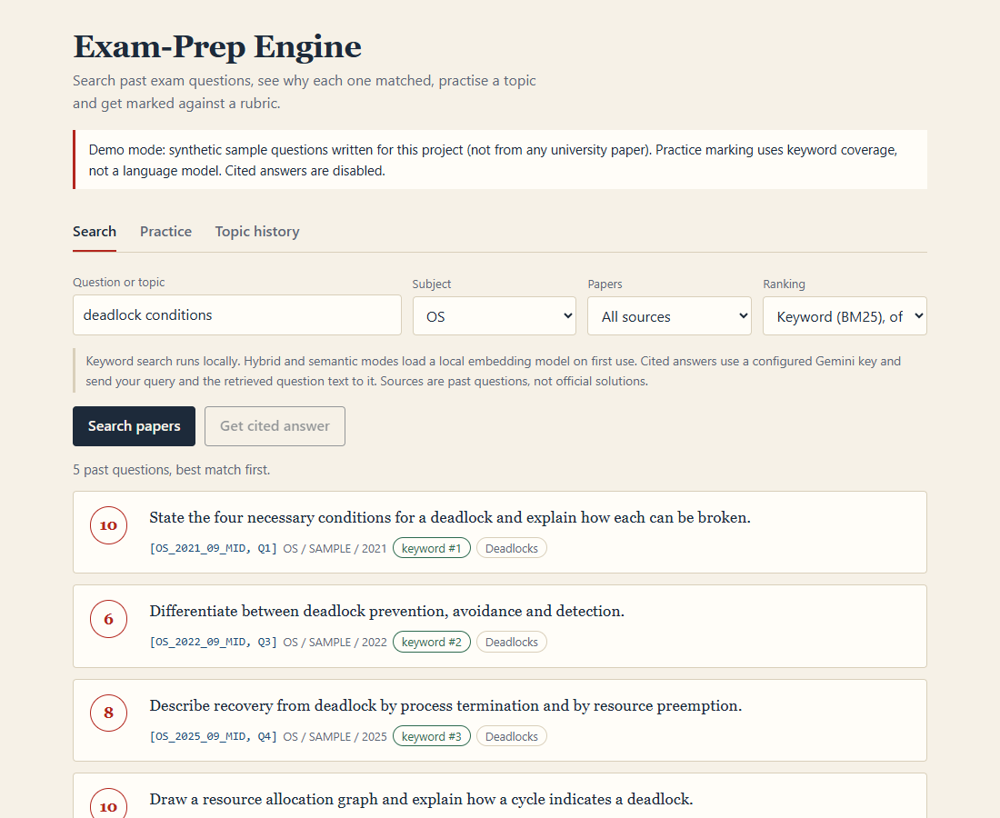
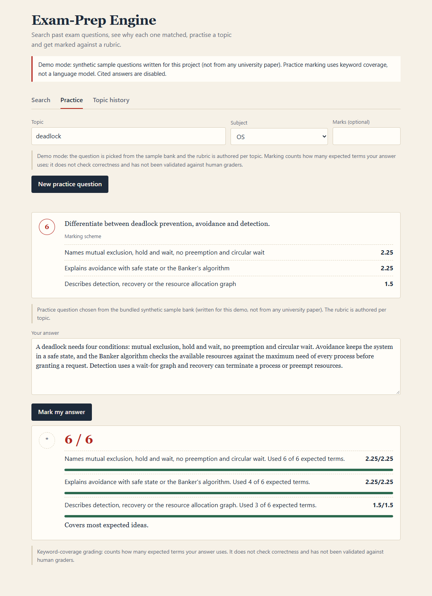
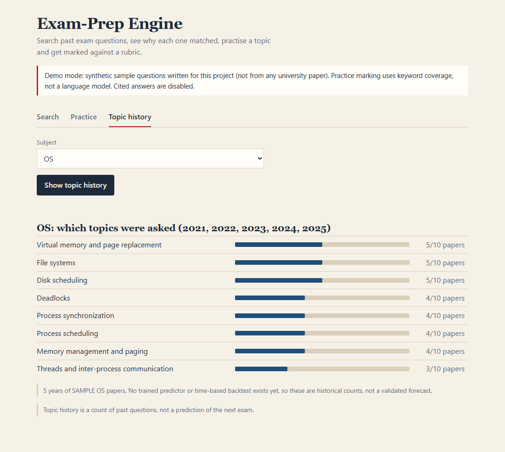
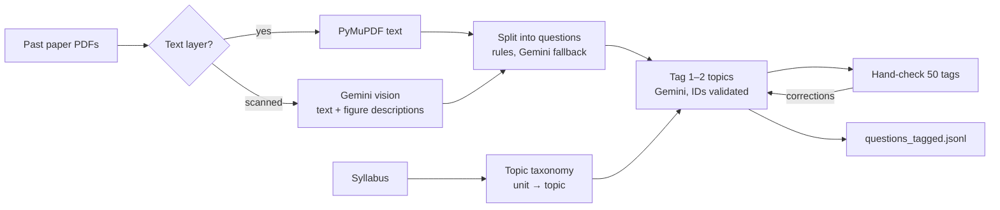
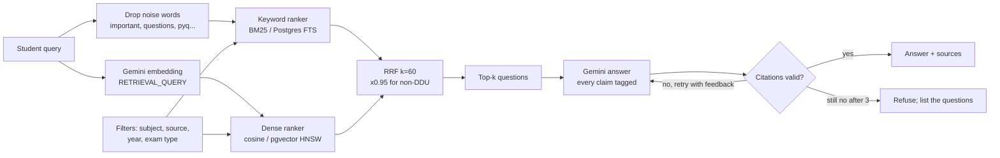

# Adaptive Exam-Prep Engine

Hybrid-retrieval study tool over university past papers (DDU Nadiad, B.Tech IT, Semester 7). It finds the exact paper and question for a topic, writes answers whose citations are validated in code, generates practice questions and grades student answers against a rubric.

## Try it now (no API key, no private data)

The repository ships a **synthetic sample bank**: 120 exam-style questions over three subjects (Operating Systems, Databases, Machine Learning), written for this project, not taken from any university paper. The demo runs entirely offline.

```powershell
python -m venv .venv; .venvScriptsctivate
pip install -r requirements-web.txt
python -m exam_prep demo          # http://127.0.0.1:8000
```

| Search with per-ranker ranks | Practice question + marking scheme + marked answer | Topic history |
| --- | --- | --- |
|  |  |  |

In demo mode practice questions come from the sample bank and answers are marked by a **keyword-coverage grader** (`exam_prep/offline.py`), not an LLM: it counts expected terms, so it can be gamed by keyword stuffing and it does not check correctness. It has not been compared with human graders. Cited answers need an LLM and are disabled. Rebuild the bank with `python scripts/build_sample_corpus.py`; the browser flows are tested by `pytest tests/test_ui_e2e.py` (needs `pip install playwright` and Microsoft Edge).

## Status and what is verified

| Item | State |
| --- | --- |
| Question bank | 15 DDU papers, 170 questions, topic-tagged; plus 382 questions from 23 other-university papers (retrieval and practice only, never counted as DDU) |
| Retrieval | Hybrid (BM25 + local `bge-base-en-v1.5` embeddings, reciprocal-rank fusion): **Recall@5 83.0%** on 111 queries (BM25 alone 78.1%, dense 79.5%). In-memory backend, not a PostgreSQL benchmark |
| Answer faithfulness | **94.1% mean RAGAS faithfulness** on 40 answers; all 40 passed the code-level citation check |
| Practice questions, rubric grading, tool router | Implemented and unit-tested with synthetic data and fake LLMs. **No accuracy figure**: grading has not been compared with human graders |
| Topic prediction | Not offered. Only one year of DDU papers exists, so `/predict` returns descriptive topic counts and `insufficient_history` |
| Deployment, student usage | None. The app runs locally. No pilot has been run and no user count is claimed |

Caveats on the numbers:

- **The 111 test queries were written and relevance-judged by an AI model (Claude)**, not by students. Keyword search already reaches 98% Hit@5 on them, so treat the absolute values as optimistic.
- **The faithfulness judge is an AI model** (Gemini, the same family as the answer generator), not a human. It is an automated check, not human validation.
- Topic tags were checked by an AI second-model review (92% fully right on a 50-tag sample), not by hand.
- The DDU papers are not in this repository (university material). `data/` holds only topic taxonomies and the query-only golden set, so the full pipeline needs your own PDFs. The tests use a synthetic question bank.

Reports: [`reports/retrieval_eval_golden_v1_bge-base-en-v1-5.md`](reports/retrieval_eval_golden_v1_bge-base-en-v1-5.md), [`reports/faithfulness_summary.md`](reports/faithfulness_summary.md).

## Container setup

The Dockerfile excludes papers, credentials, caches and model files from the build context. Build with `docker build -t exam-prep .` (`--build-arg INCLUDE_AGENT=0` omits LangGraph); mount your own `data` directory at `/app/data` and provide `GEMINI_API_KEY` at runtime for answers, practice and grading. Publish port 7860 to loopback only.

## Practice, rubric grading and explicit tool routing

`/predict` counts DDU papers only; with one available year it reports `insufficient_history` and refuses trained forecasts.

`POST /practice` accepts `subject`, `topic` and optional `marks`. References and topic IDs must come from retrieved questions, and positive rubric marks must sum to the total. `POST /grade` accepts `question`, `rubric` and `answer`; every rubric point gets a score bounded by its maximum. Both retry invalid model output, then refuse. Grading is AI feedback.

`POST /agent` accepts `operation` and `args` (`search_papers`, `predict_topics`, `generate_question`, `grade_answer`). LangGraph routes the explicitly requested operation; it is not autonomous natural-language planning. Without LangGraph, `/agent` returns 503 and the direct endpoints keep working. Install `requirements-agent.txt` in a separate environment from `requirements-eval.txt` (their LangChain requirements conflict).

Phase A turns DDU past papers into a clean, topic-tagged question bank. Phase B searches that bank with hybrid retrieval and writes answers whose citations are checked (see [Phase B](#phase-b-hybrid-retrieval-with-checked-citations)).



## Setup

```bash
python -m venv .venv && source .venv/bin/activate      # Windows: .venv\Scripts\activate
pip install -r requirements.txt
cp .env.example .env                                     # then paste your key from aistudio.google.com/apikey
pytest -q                                                # no API key or database needed
```

Try it before collecting papers: `python scripts/make_sample_paper.py`, then run steps 1–2 below. Delete `data/raw/OS/` afterwards.

## Folder layout

| Path | What goes there | Who writes it |
| --- | --- | --- |
| `data/raw/<SUBJECT>/` | Paper PDFs named `OS_2025_11_END.pdf` (subject, year, month, MID / END / REM) | You |
| `data/external/<SUBJECT>/` | Other universities' papers named `BITM-AI_2019_11_END.pdf` (source prefix), provenance in `data/external/SOURCES.csv`. Retrieval/practice only | You |
| `data/papers.csv` | Optional: `file,subject,year,month,exam_type` for PDFs you don't want to rename | You |
| `data/syllabus/<SUBJECT>.txt` | Syllabus pasted from the DDU syllabus PDF (or `<SUBJECT>.pdf`) | You |
| `data/taxonomy/<SUBJECT>.json` | Unit → topic list with IDs like `OS-U3-T2`; edit it by hand | `syllabus`, then you |
| `data/interim/pages/` | Page text per paper | `extract` |
| `data/processed/questions.jsonl` | One row per question or sub-part | `split` |
| `data/processed/tags.jsonl` | Model topic tags | `tag` |
| `data/processed/tag_overrides.jsonl` | Your corrections; always win | `review score` |
| `data/processed/questions_tagged.jsonl` | Final output for Phase B | `export` |
| `data/review/` | Hand-check CSVs and accuracy reports | `review` |
| `data/cache/llm/` | Every Gemini response, so re-runs cost nothing | automatic |
| `data/cache/embeddings/` | Every embedding vector, keyed by model, dimensions, task type and text | `index`, `search`, `ask` |

Everything under `data/` except taxonomies and `data/external/SOURCES.csv` is git-ignored: papers stay off GitHub.

## Run it, step by step

1. **Collect papers.** Pick 2 subjects with 5+ years of papers. Name files `SUBJECT_YYYY_MM_EXAM.pdf`.
2. **Extract** — `python -m exam_prep extract`
    - Digital pages: free, instant. Scanned pages: Gemini vision, which also describes tables and diagrams in words.
3. **Split** — `python -m exam_prep split`
    - `auto` (default): rules first; Gemini only if the rules output looks wrong.
    - Every Gemini-split question is checked against the paper: at least 80% of its 20-character chunks must appear on one page (margin codes and `[marks]` ignored), otherwise it is printed as a warning.
    - DDU layout (`CO1 R (a) … [2]`) is handled by the rules; column layouts like the AI papers need `--method llm`.
    - Other universities: `python -m exam_prep split --source external --method llm`.
    - Open `questions.jsonl` and spot-check 2 papers before going on.
4. **Syllabus** — `python -m exam_prep syllabus --subject OS`
    - Then **edit `data/taxonomy/OS.json` by hand**: merge tiny topics, split huge ones. Tag quality depends on this file more than on the prompt.
5. **Tag** — `python -m exam_prep tag --subject OS --limit 16` to try the prompt cheaply, then without `--limit`.
    - The model may answer `off_syllabus` when no topic fits. Expected for other universities' questions; for a DDU question it is flagged for review, since it means the taxonomy is missing a topic.
6. **Hand-check** (see below), then **export** — `python -m exam_prep export` and `python -m exam_prep stats`.

`python -m exam_prep all` runs extract → split → tag → export once taxonomies exist.

## The hand-check loop

| Step | Command | What you do |
| --- | --- | --- |
| Sample | `python -m exam_prep review sample --n 50` | Opens nothing; writes `data/review/tag_review_tag_v1.csv` |
| Judge | Open the CSV in Sheets / Excel | `verdict`: `y` right, `p` partly, `n` wrong. For `p` / `n`, put right IDs in `correct_topic_ids` (`OS-U3-T1;OS-U3-T2`) |
| Score | `python -m exam_prep review score` | Prints accuracy, writes `report_tag_v1.md`, saves your fixes as overrides |
| Improve | Add `exam_prep/prompts/tag_v2.txt`, run `tag` again | New version is picked up automatically; old tags are re-done |

Every low-confidence or failed tag is always in the sample. Keep the reports: "tag accuracy went from X% (v1) to Y% (v2) on 50 hand-checked questions" is a real, defensible resume line.

## Output row (`questions_tagged.jsonl`)

```json
{"question_id": "OS_2025_11_END-Q2a", "paper_id": "OS_2025_11_END", "subject": "OS", "exam_type": "end",
 "year": 2025, "month": 11, "question_no": "2", "sub_part": "a", "marks": 6.0, "is_or_alternative": false,
 "text": "Explain the Banker's algorithm for deadlock avoidance with an example.", "page": 1,
 "split_method": "rules", "topic_ids": ["OS-U3-T3"], "topics": ["Banker's algorithm"], "units": [3],
 "tag_source": "llm", "tag_confidence": "high", "source": "DDU", "co": "CO3", "bloom": "A", "off_syllabus": false}
```

## Phase B: hybrid retrieval with checked citations



| Piece | Choice | Why |
| --- | --- | --- |
| Chunk | One question or sub-part, text plus its topic names | Questions are short and self-contained; topic names connect "deadlock" to a question that only says "Banker's algorithm" |
| Embeddings | `gemini-embedding-001`, 768 dims, L2-normalised, separate document and query task types | Free tier, 100 texts per call, cached on disk. `gemini-embedding-2` merges a list of texts into one vector, so it would need one call per question |
| Keyword | Okapi BM25 (memory backend) or `ts_rank_cd` on a stemmed `tsvector` (Postgres) | Exact terms like "Dockerfile" or "A*" that embeddings blur |
| Fusion | Reciprocal Rank Fusion, k = 60 | Needs no score calibration between the rankers |
| DDU preference | Non-DDU fused scores × `EXTERNAL_WEIGHT` (0.95, about 3 places near the top) | Students want their own university's questions first; other papers stay available as practice |
| Answer | Sources are questions, not answers, so the reply describes what has been asked, with marks and repeats | Nothing is stated that the papers don't contain |
| Citation check | Every tag must be a retrieved question, every content line needs a tag, at least one tag; 3 attempts, then refuse | Hallucinated citations are caught in code, not trusted |

Two backends share the same fusion code:

- `memory` (default): numpy plus BM25. Needs no setup. Used by the tests and by the Phase C evaluation.
- `pg`: Postgres + pgvector with an HNSW index, a GIN full-text index and SQL filters. Setup is in `exam_prep/pgstore.py`. One command (`docker run ... pgvector/pgvector:pg17`) starts it on port 5433; then run `python -m exam_prep index --backend pg`.

```bash
python -m exam_prep index                                         # embed all questions (cached)
python -m exam_prep search "important questions on deadlock" --subject DC
python -m exam_prep search "docker" --subject DC --mode bm25      # or dense / hybrid (default)
python -m exam_prep search "A* search" --source DDU --year-from 2024
python -m exam_prep ask "what do they ask about transformers?" --subject MLDL
```

## Local web app (search page + API)

A FastAPI app over the same retriever and answer code: `exam_prep/web.py` (API) and `exam_prep/web.html` (page, no build step).

```bash
pip install -r requirements-web.txt             # requirements.txt + fastapi, uvicorn, httpx
python -m exam_prep export                      # the app reads data/processed/questions_tagged.jsonl
uvicorn exam_prep.web:app --port 8000           # then open http://127.0.0.1:8000
```

| Endpoint | What it does | Needs |
| --- | --- | --- |
| `GET /` | Search page: query, subject, DDU / other universities, search method | — |
| `GET /health` | `question_bank` (export file exists), `data_loaded`, `answers_configured` (yes/no only, never the key). Loads nothing | — |
| `POST /search` | Top-k questions with `citation`, marks, source, ranks. `mode`: `bm25` (default) / `dense` / `hybrid` | `bm25`: nothing, fully offline. `dense` / `hybrid`: local `bge-base` via fastembed (downloaded once, ~0.2 GB) |
| `POST /ask` | Cited answer; every citation is checked in code, 3 attempts, then a refusal plus the sources | `GEMINI_API_KEY`; sends the query and retrieved question text to Gemini |

Request body for both POSTs: `{"query": "...", "subject": "DC", "source": "DDU", "year_from": 2024, "year_to": 2025, "mode": "bm25", "k": 5}` (only `query` is required).

```powershell
Invoke-RestMethod -Method Post -Uri http://127.0.0.1:8000/search -ContentType 'application/json' -Body '{"query": "deadlock", "subject": "DC"}'
```

- Bad input returns 422 before any data or model is loaded. Failures return a short fixed message (503 for a missing question bank, package, API key, quota or network; 500 otherwise). Error text from Gemini is never returned or logged; the log shows the exception type and the file:line it came from.
- Only `localhost` / `127.0.0.1` Host headers are accepted (this blocks DNS-rebinding pages from spending your Gemini quota). To deploy, set `WEB_ALLOWED_HOSTS=localhost,127.0.0.1,your.domain`.
- Retrieval is serialised by its own lock, and Gemini answers by another, so a slow answer never blocks a keyword search.
- Tests: `tests/test_web.py` runs real retrieval over a synthetic question bank with a fake embedder and a scripted LLM (no key, no network). It skips when FastAPI is not installed; CI installs `requirements-web.txt`.

## Phase C: evaluation

```mermaid
flowchart LR
    G[Golden set<br/>data/golden/golden_vN.jsonl] --> R[evaluate<br/>bm25 / dense / hybrid<br/>+ ablations]
    R --> M[Recall@5, Hit@5,<br/>MRR@10, nDCG@10<br/>bootstrap 95% CI]
    G --> A[evaluate-answers<br/>sample per subject]
    A --> P[hybrid -> Gemini answer<br/>-> citation check]
    P --> J[RAGAS Faithfulness<br/>Gemini judge]
    M --> F[reports/*.md + MLflow]
    J --> F
    H[Classmates' queries CSV] --> PL[golden pool<br/>top-10 of every ranker]
    PL --> JU[judge y/n] --> I[golden import<br/>-> golden_vN+1]
```

| Piece | What it does |
| --- | --- |
| `data/golden/golden_v1.jsonl` | 111 queries (AI 25, DC 28, MLDL 31, WT 27; topic / specific / paraphrase), each with every relevant question ID. Written and judged by Claude (AI) against each subject's full question bank, from question text only, never from topic tags (the index contains tag names, so tag-based labels would be circular) |
| `evaluate` | Recall@5, Hit@5, MRR@10, nDCG@10 for bm25, dense, hybrid; ablations without topic names and with other external weights; paired bootstrap CI for hybrid − bm25 and hybrid − dense; by type, subject and author; report in `reports/`, runs in MLflow (`mlflow ui`) |
| `evaluate-answers` | 10 queries per subject run end to end; RAGAS `Faithfulness` with a Gemini judge; also citation-check pass rate, first-try rate, refusals |
| `golden pool` / `golden import` | Adds human-written queries: pool the top 10 of every ranker, judge y/n blind to ranker order, import as `golden_v(N+1)` with `H-` IDs |

```bash
pip install -r requirements-eval.txt        # RAGAS + MLflow (separate: RAGAS needs LangChain 0.3)
python -m exam_prep evaluate                # retrieval comparison -> reports/retrieval_eval_golden_v1.md
python -m exam_prep evaluate --bm25-only    # needs no embedding quota
python -m exam_prep evaluate-answers        # RAGAS faithfulness -> reports/answer_eval_golden_v1.md
python -m exam_prep golden pool --input data/golden/classmates.csv
python -m exam_prep golden import --input data/golden/judge_classmates.csv
```

### Results so far (golden_v1, AI-written, local embeddings `BAAI/bge-base-en-v1.5`)

Full report: `reports/retrieval_eval_golden_v1_bge-base-en-v1-5.md`.

| Setup | Recall@5 | Hit@5 | MRR@10 | nDCG@10 |
| --- | --- | --- | --- | --- |
| BM25 | 78.1% | 98.2% | 0.946 | 0.877 |
| Dense | 79.5% | 100.0% | 0.941 | 0.878 |
| **Hybrid (RRF)** | **83.0%** | 99.1% | **0.955** | **0.906** |
| Hybrid without topic names in the index | 79.3% | 98.2% | 0.937 | 0.873 |

- Hybrid − BM25 Recall@5: +4.9 points, 95% CI [+2.5, +7.4]: significant. Hybrid − dense: +3.5 points, CI [−0.0, +6.9]: not significant. MRR differences: not significant (all near the ceiling).
- Adding topic names to the index helps every ranker (+3.7 points Recall@5 for hybrid).
- Dense wins on paraphrase queries (90.1% vs 84.9% hybrid, n = 16); hybrid wins on topic and specific queries.
- Gemini embeddings (`gemini-embedding-001`) will be added as a second dense model once the daily quota allows.

Two embedding providers (`EMBED_PROVIDER` or `--embedder`):

| Provider | Model | Cost / limits | Use |
| --- | --- | --- | --- |
| `gemini` (default) | `gemini-embedding-001`, 768 d | Free tier, about 1,000 texts a day, counted per text | Best-known quality; quota runs out quickly once users search |
| `local` | `BAAI/bge-base-en-v1.5` via fastembed (ONNX, CPU), 768 d | Free, offline, about 0.2 GB download | No quota; same dimensions, so the pgvector schema is unchanged |

Honesty rules for these numbers:

- The v1 golden set was written by an AI that had read the questions, so even its "paraphrase" queries reuse some exam wording, which favours keyword search. BM25 alone already reaches 98% Hit@5 on it. Quote it as "on an AI-written 111-query golden set" until human queries are added.
- Ask 2+ classmates to write 20 queries each **without looking at the papers** (`data/golden/queries_template.csv`), then pool, judge and re-run. The report splits every metric by author.
- Free-tier quota: embeddings count every text (about 1,000 a day). A full `evaluate` needs about 663 new embeddings (111 queries + 552 questions without topic names); everything is cached afterwards.

## Design notes (interview talking points)

- **Text layer first, vision only when needed** — keeps free-tier usage to scanned pages.
- **Structured output everywhere** — every Gemini call returns a Pydantic schema; topic IDs are checked against the taxonomy, and invalid ones are retried, then flagged.
- **Verbatim check** — Gemini-split questions must match the source text, so rephrased or invented questions can't enter the bank.
- **Versioned prompts** — `prompts/<name>_vN.txt`; every tag records its prompt version and model.
- **Disk cache + rate limiter + backoff** — re-runs are free and 429s are retried.
- **Human overrides** — corrections are stored separately and always win, so re-tagging never loses them.
- **Source-aware data** — other universities' papers widen the retrieval and practice bank, but headline counts and topic prediction use DDU papers only, so the numbers stay honest.
- **Robust to a busy free tier** — request timeout, retries on 503 and dropped connections, and finished papers are saved even if a later call fails.

## Troubleshooting

| Problem | Fix |
| --- | --- |
| `Can't read metadata from scan0001.pdf` | Rename it, or add a row to `data/papers.csv` |
| A paper splits into 1–2 questions | Its layout isn't `Q.1 / (a)`: run `split --method llm` for it |
| 429 / quota errors | Lower `GEMINI_RPM` in `.env`; cached calls are never repeated |
| 503 "high demand" / 504 timeouts | Free-tier overload: just re-run, finished work is cached. If one model keeps timing out, switch it in `.env` (3.8 Flash did on 2026-11-12; 3.6 Flash worked) |
| Model not found | Model IDs change: set `GEMINI_MODEL` / `GEMINI_VISION_MODEL` to one listed in AI Studio |
| Marks missing on many questions | Check one paper's page text in `data/interim/pages/` and adjust `MARKS_END` in `split.py` |

## What Phase A gives the resume

Run `python -m exam_prep stats` and use the real numbers only: DDU papers, questions, subjects, and the tag accuracy from your review report. `external_*` numbers describe the practice bank and must not be added to the DDU paper count.
